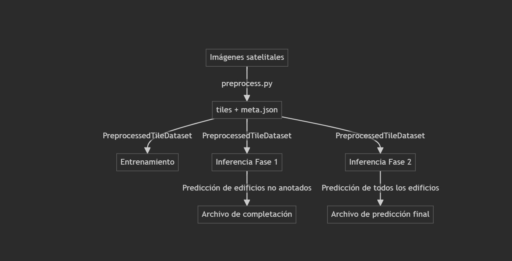
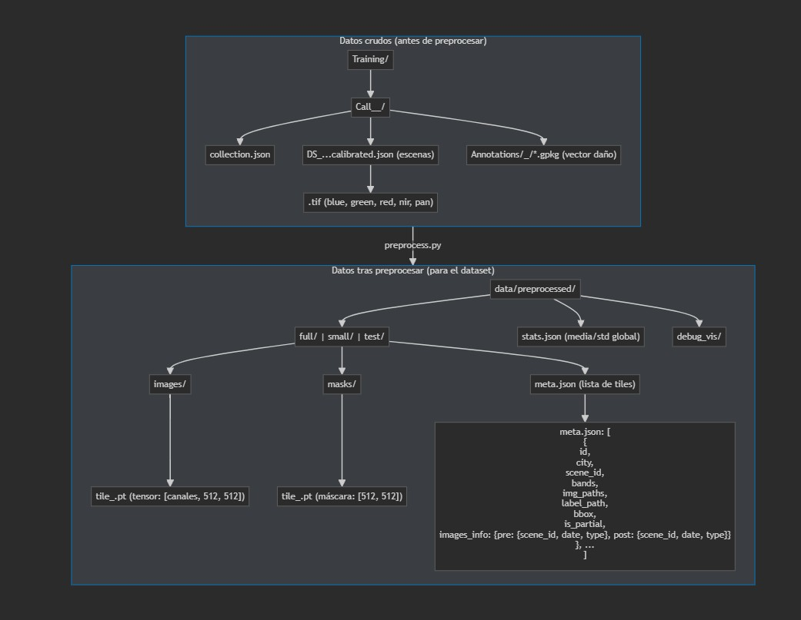
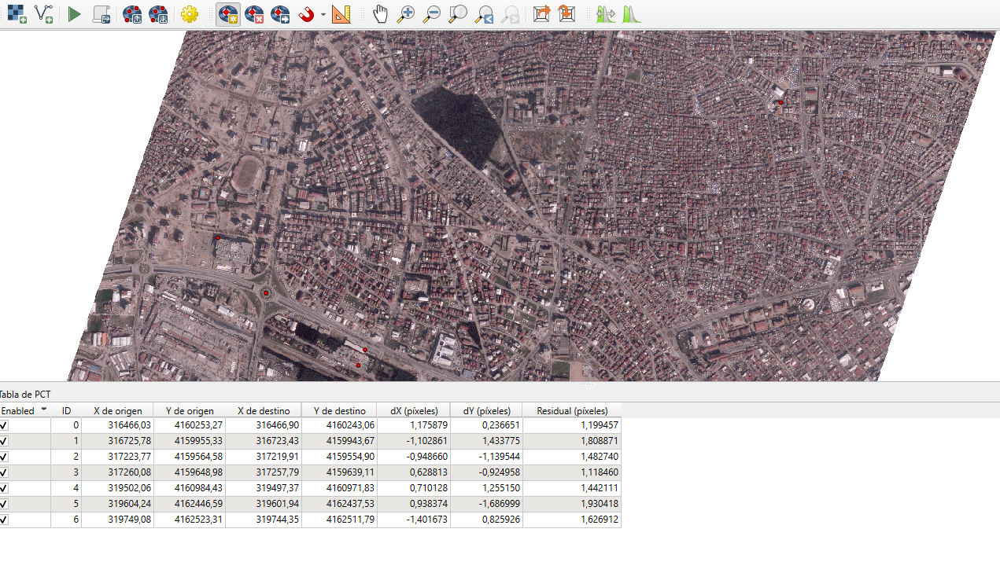
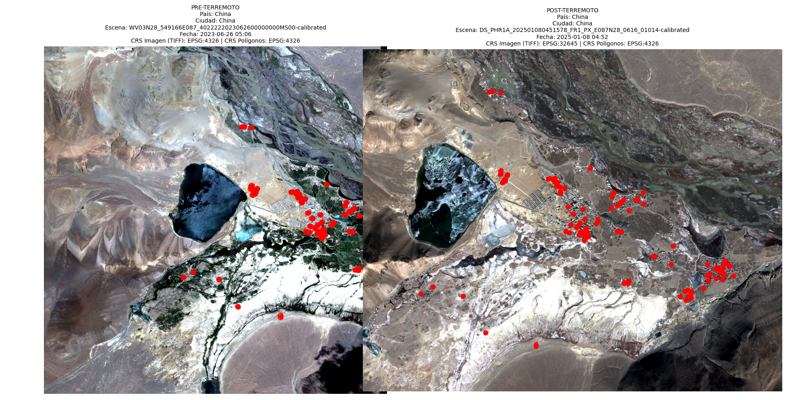
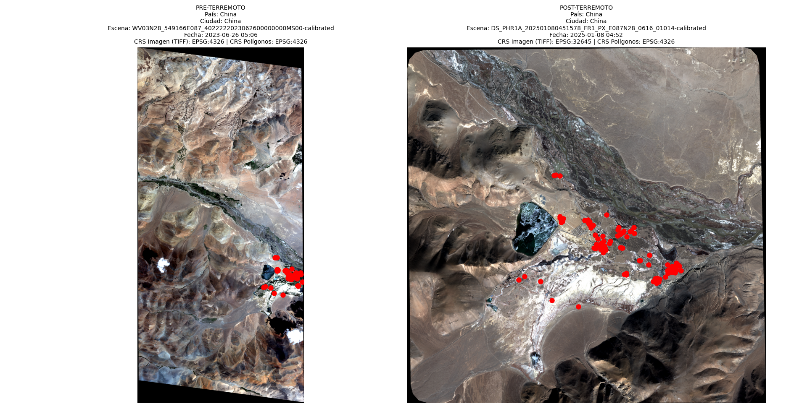
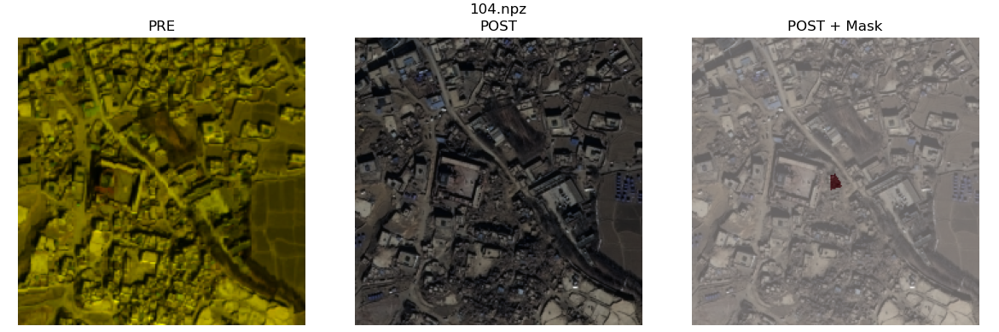
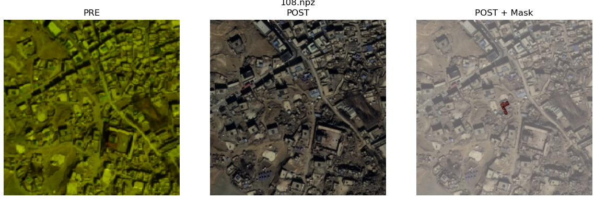

[English](README.md) | **Español**

# AI for Earthquake Response

Nuestra solución para la competición [AI for Earthquake Response](https://platform.ai4eo.eu/ai-for-earthquake-response) de ESA Phi-lab y el International Charter "Space and Major Disasters".

El reto: dadas imágenes de satélite de alta resolución de antes y después de un terremoto y los polígonos de los edificios de la zona, decir qué edificios están dañados (1) y cuáles no (0). La idea de fondo es poder generar mapas de daños rápido después de un sismo para que los equipos de rescate sepan dónde ir primero.

Los datos cubren terremotos en Turquía (Adiyaman, Antakya, Marash), Siria, China, Marruecos, Myanmar y Afganistán, con imágenes de distintos satélites (WorldView, Pléiades...), cada uno con su resolución y sus bandas.

## Cómo lo hemos planteado

1. **Preprocesamiento**: para cada edificio buscamos la mejor escena pre y post evento, recortamos un tile centrado en el edificio (224 px por defecto, con 20 m de margen alrededor) y lo guardamos en `.npz` junto a su etiqueta.
2. **Modelo siamés**: el mismo backbone procesa el tile de antes y el de después, y una cabeza compara las dos representaciones para decidir si hay daño.
3. **Inferencia**: el modelo entrenado etiqueta los edificios de los `.gpkg` de test y genera los archivos de submission por ciudad.



## Datos

Los datos no están en el repo, hay que pedirlos:

1. Registrarse en la [plataforma AI4EO](https://platform.ai4eo.eu/ai-for-earthquake-response).
2. Crear cuenta en [EOTDL](https://www.eotdl.com) con el mismo email.
3. Esperar el acceso (puede tardar hasta 48 h) y descargar el dataset en `data/international-charter-eo4ai-etq-challenge/`.



En `objetivo.md` está la descripción completa del dataset, del formato de las anotaciones y de cómo tiene que ser la submission.

## Preprocesamiento

`src/preprocess.py` hace todo el trabajo pesado:

- Saca la fecha del terremoto de cada evento y separa las escenas en pre y post.
- Para cada edificio elige la mejor escena de cada lado según cobertura y cercanía a la fecha, con fallback a otras escenas si la mejor no cubre el polígono.
- Lleva todas las escenas a una resolución común, recorta el tile y rasteriza la máscara del edificio.
- Lo hace en paralelo con varios workers.

```bash
python src/preprocess.py \
  --data-root data/international-charter-eo4ai-etq-challenge \
  --output-dir preprocessed \
  --tile-size 224 \
  --buffer-meters 20
```

Con `--country` se puede procesar un solo país y con `--satellites` filtrar por sensor.

Algo que nos encontramos enseguida es que muchos edificios no tienen escena pre que los cubra. En una de las áreas de Afganistán, por ejemplo, el 78,7 % de los edificios no tenía imagen de antes. Por eso el emparejamiento de escenas tiene tantos fallbacks.



### Por qué acabamos usando QGIS

Al principio intentamos alinear y hacer el pansharpening de las imágenes solo con código (`rasterio`, `gdal`, `opencv`), pero había desalineaciones entre las capas pre y post que no conseguíamos quitar, el pansharpening automático daba errores con las imágenes multiespectrales y algunas proyecciones no se resolvían bien.

Al final esa parte la hicimos en QGIS: cargar las imágenes pre y post, corregir los desplazamientos con georreferenciación manual por puntos de control, hacer el pansharpening, exportar a GeoTIFF y meter el resultado en el pipeline de `preprocess.py`. Los proyectos de QGIS de cada país están en `data/*.qgz`. Para un modelo que compara antes y después, que las dos imágenes estén bien alineadas es lo que más importa, y así mejoró bastante la calidad del dataset.

## Modelos

Todos están en `src/model.py` y se eligen con `--model`. La base es `siamese_cnn_classifier`, y sobre esa idea probamos distintas cabezas para comparar pre y post:

| Modelo | Idea |
|---|---|
| `siamese_cnn_classifier` | Backbone CNN compartido, concatena features pre y post y clasifica |
| `siamese_cnn_classifier_fpn` | Igual pero con FPN para combinar varias escalas |
| `correlation_siamese_head` | Correlación entre los mapas de features de antes y después |
| `cross_attention_transformer_head` | Atención cruzada entre pre y post |
| `aspp_style_head` | Convoluciones dilatadas tipo ASPP |
| `relation_network_head` | Relation network entre las dos ramas |
| `temporal_conv3d_head` | Trata pre y post como una secuencia temporal con convoluciones 3D |
| `prototype_based_head` | Distancia a prototipos de clase |
| `multitask_head` | Varias salidas a la vez |
| `siamese_efficientnet_classifier` / `siamese_efficientnet_fpn` | Lo mismo con EfficientNet-B0 de backbone |

## Entrenamiento

```bash
python src/train.py --config config.yaml --model siamese_cnn_classifier --epochs 10
```

Opciones útiles:

- `--mode pre_post | pre_only | post_only`: qué imágenes usar.
- `--loss_type bce | dice | bce_dice | focal`: hay muchos menos edificios dañados que sanos, así que la loss y los `class_weights` del config importan bastante.
- `--small_dataset`: entrena con un 20 % de los datos para probar rápido.
- `--resume`: para seguir desde un checkpoint.

El entrenamiento tiene mixed precision, early stopping y scheduler cosine con warmup. Los logs se pueden ver con TensorBoard o Weights & Biases.

## Inferencia y submission

```bash
python src/test.py \
  --model_path outputs/models/checkpoint_epoch_2.pth \
  --input_dir submissions/submission_1 \
  --output_dir submissions/submission_5
```

Genera un `.gpkg` por ciudad (`adiyaman`, `antakya_east`, `china`, `marash`) con la etiqueta de cada edificio. En `submissions/` están las que fuimos enviando.

## Visualización

Para revisar los tiles y las predicciones usamos `src/visualizar_tiles.py` y `src/visualizar_escenas.py`.

| Vista cercana | Vista lejana |
|---|---|
|  |  |





## Scripts de prueba

En `proof_scripts/` están los scripts que fuimos haciendo para depurar el dataset: comprobar tiles defectuosos, ver qué bandas tiene cada escena, listar las fechas de las imágenes, visualizar el contenido de los `.gpkg` o un tile pre/post concreto, revisar batches con augmentation, etc. Varios son específicos de problemas que nos dieron Afganistán y Adiyaman.

## Estructura

```
AIFOREARTHQUAKE/
├── config.yaml            Configuración principal
├── configs/               Otras configuraciones de prueba
├── data/                  Proyectos QGIS (.qgz) e imágenes del README
├── src/
│   ├── preprocess.py      Emparejamiento de escenas y generación de tiles
│   ├── data_loader.py     Dataset y DataLoaders
│   ├── model.py           Modelos siameses y cabezas
│   ├── train.py           Entrenamiento
│   ├── test.py            Inferencia y submission
│   ├── transforms.py      Augmentations
│   ├── sampler_aug.py     Sampler con augmentation
│   ├── train_backbone.py  Preentrenamiento del backbone
│   └── visualizar_*.py    Visualización de tiles y escenas
├── proof_scripts/         Scripts de depuración y análisis
├── submissions/           Submissions enviadas
└── objetivo.md            Descripción del reto y del dataset
```

## Instalación

```bash
pip install -r requirements.txt
```

Hace falta GPU con CUDA para entrenar en un tiempo razonable. Para el preprocesamiento usamos un entorno de conda aparte con `rasterio`, `geopandas` y `fiona`.

## Equipo

[Sauvageduck24](https://github.com/Sauvageduck24) y [SilverDelgado](https://github.com/SilverDelgado).

Licencia MIT.
