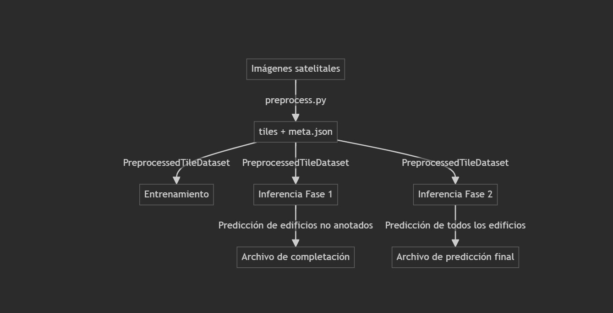
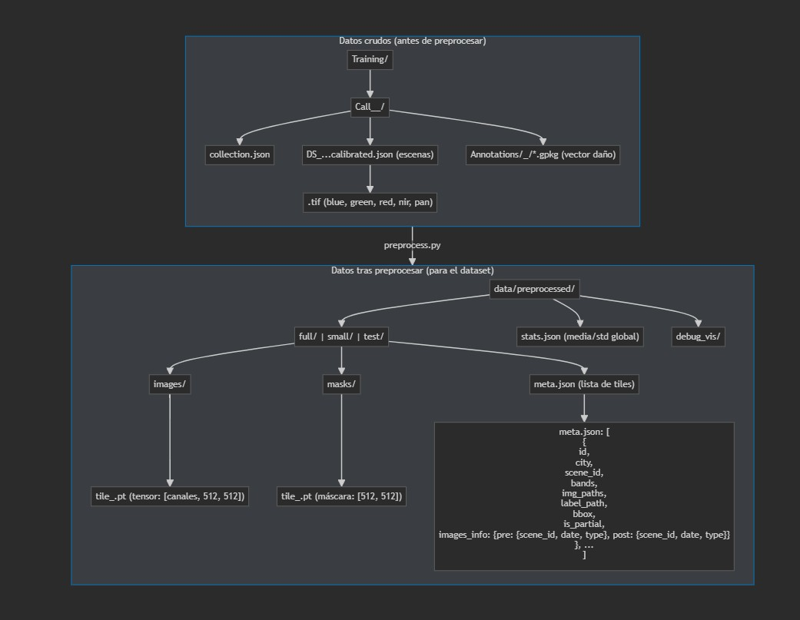

# AI for Earthquake Response - Deep Learning Project

Este proyecto implementa modelos de deep learning para la detección automática de daños en edificios tras terremotos utilizando imágenes satelitales multitemporales (antes y después del evento).

---



---

## 🏆 Competición

Este proyecto participa en la competición **[AI for Earthquake Response](https://platform.ai4eo.eu/ai-for-earthquake-response)** organizada por ESA Φ-lab y el International Charter 'Space and Major Disasters'.

## 🎯 Objetivo

Desarrollar modelos de IA capaces de identificar automáticamente edificios dañados vs. no dañados analizando imágenes satelitales de alta resolución pre y post-terremoto.

## 📁 Estructura del Proyecto

La siguiente imagen muestra la estructura general del repositorio:


También se detalla a continuación:

```
AIFOREARTHQUAKE/
├── data/                   # Datasets locales y preprocesados
├── notebooks/              # Jupyter notebooks para exploración
├── src/                    # Código fuente principal
│   ├── data_loader.py      # Carga de datos y DataLoaders
│   ├── transforms.py       # Transformaciones y aumentos
│   ├── model.py            # Definición de modelos
│   ├── train.py            # Entrenamiento y validación
│   ├── utils.py            # Utilidades y métricas
│   └── config.py           # Configuración del experimento
├── outputs/                # Modelos, logs y predicciones
├── scripts/                # Scripts de ejecución
├── requirements.txt        # Dependencias
└── README.md               # Este archivo
```

## 🚀 Instalación

1. **Clonar el repositorio:**
```bash
git clone <repository-url>
cd AIFOREARTHQUAKE
```

2. **Crear entorno virtual:**
```bash
python -m venv venv
source venv/bin/activate  # Linux/Mac
# o
venv\Scripts\activate     # Windows
```

3. **Instalar dependencias:**
```bash
pip install -r requirements.txt
```

## 📊 Preparación de Datos

1. **Acceso al dataset:**
   - Registrarse en [AI4EO Platform](https://platform.ai4eo.eu/ai-for-earthquake-response)
   - Crear cuenta en [EOTDL](https://www.eotdl.com) con el mismo email
   - Esperar hasta 48h para acceso al dataset

2. **Estructura de datos esperada:**
```
data/
├── raw/                    # Datos originales
│   ├── scene_001/
│   │   ├── pre_event/      # Imágenes pre-terremoto
│   │   ├── post_event/     # Imágenes post-terremoto
│   │   └── annotations/    # Máscaras de daño
│   └── ...
├── processed/              # Datos preprocesados
└── splits/                 # Particiones train/val/test
```

## Estructura del dataset y preprocesamiento

El siguiente diagrama muestra cómo están organizados los datos antes y después de ejecutar el preprocesamiento:



### Descripción del flujo de datos

- **Datos crudos (antes de preprocesar):**
  - Carpeta `Training/` con subcarpetas por ciudad (`Call_<ID>_<Ciudad>/`).
  - Cada ciudad contiene:
    - `collection.json`: catálogo STAC de escenas.
    - Archivos `.json` de escenas calibradas (con referencias a las bandas).
    - Archivos `.tif` de bandas espectrales (blue, green, red, nir, pan).
    - Anotaciones vectoriales de daño en `Annotations/<ID>_<Ciudad>/*.gpkg`.

- **Preprocesamiento (`preprocess.py`):**
  - Lee y organiza las imágenes pre y post evento.
  - Genera tiles normalizados y máscaras rasterizadas.
  - Calcula estadísticas globales (media y std).
  - Guarda overlays de debug si se solicita.

- **Datos tras preprocesar (para el dataset):**
  - Carpeta `data/preprocessed/` con splits: `full/`, `small/`, `test/`.
  - Cada split contiene:
    - `images/`: tiles de imágenes como tensores `.pt` ([canales, 512, 512]).
    - `masks/`: máscaras de daño como tensores `.pt` ([512, 512]).
    - `meta.json`: lista de metadatos de cada tile, incluyendo:
      - id, ciudad, escena, bandas, paths, bbox, is_partial, y un campo `images_info` con la información de las imágenes pre y post usadas (scene_id, fecha, tipo).
  - Archivo `stats.json` con media y desviación estándar global.
  - Carpeta `debug_vis/` con visualizaciones opcionales.

Para más detalles, consulta el código fuente de `preprocess.py` y el ejemplo de salida en la carpeta `data/preprocessed/`.

## 🏗️ Entrenamiento

### Entrenamiento Básico
```bash
python scripts/train.py --config configs/baseline.yaml
```

### Entrenamiento Distribuido (DDP)
```bash
python -m torch.distributed.launch --nproc_per_node=4 scripts/train.py --config configs/baseline.yaml --distributed
```

### Entrenamiento con Múltiples Seeds
```bash
python scripts/train_multiple_seeds.py --config configs/baseline.yaml --seeds 42 123 456
```

## 🔍 Evaluación

```bash
python scripts/evaluate.py --model_path outputs/models/best_model.pth --data_path data/processed/test
```

## 📈 Predicción

```bash
python scripts/predict.py --model_path outputs/models/best_model.pth --input_path data/raw/new_scene --output_path outputs/predictions
```

## 📋 Configuración

El archivo `src/config.py` contiene todos los parámetros configurables:

- **Modelo**: Arquitectura, backbone, hiperparámetros
- **Datos**: Rutas, transformaciones, batch size
- **Entrenamiento**: Optimizador, learning rate, epochs
- **Hardware**: GPU, workers, distributed training

## 🧪 Experimentos

### Notebooks de Exploración
- `notebooks/01_data_exploration.ipynb`: Análisis exploratorio de datos
- `notebooks/02_model_prototyping.ipynb`: Prototipado de modelos
- `notebooks/03_results_analysis.ipynb`: Análisis de resultados

### Configuraciones Predefinidas
- `configs/baseline.yaml`: Configuración base
- `configs/unet_resnet50.yaml`: UNet con ResNet-50
- `configs/segmentation_transformer.yaml`: Transformer para segmentación

## 📊 Métricas

El proyecto implementa las siguientes métricas:
- **IoU (Intersection over Union)**
- **Dice Coefficient (F1-Score)**
- **Precision y Recall**
- **Accuracy**

## 🛠️ Características Avanzadas

- ✅ **Entrenamiento Distribuido (DDP)** para escalabilidad
- ✅ **Múltiples Seeds** para reproducibilidad
- ✅ **Logging con TensorBoard/WandB**
- ✅ **Checkpointing** automático
- ✅ **Early Stopping** configurable
- ✅ **Data Augmentation** con Albumentations
- ✅ **Mixed Precision Training** (AMP)

## 🤝 Contribución

1. Fork el proyecto
2. Crear rama feature (`git checkout -b feature/AmazingFeature`)
3. Commit cambios (`git commit -m 'Add AmazingFeature'`)
4. Push a la rama (`git push origin feature/AmazingFeature`)
5. Abrir Pull Request

## 📄 Licencia

Este proyecto está bajo la Licencia MIT. Ver `LICENSE` para más detalles.

## 🙏 Agradecimientos

- **ESA Φ-lab** por organizar la competición
- **International Charter 'Space and Major Disasters'** por proporcionar los datos
- **AI4EO Platform** por facilitar la competición

## 📞 Contacto

Para preguntas sobre este proyecto, abrir un issue en GitHub.

---

**Nota**: Este proyecto es parte de la competición [AI for Earthquake Response](https://platform.ai4eo.eu/ai-for-earthquake-response). Los datos están sujetos a restricciones de acceso y deben ser solicitados manualmente al equipo organizador. 

## 👥 Autores

El equipo **MM** está formado por:
- Esteban Sánchez Gámez
- Pablo Delgado Muñoz 