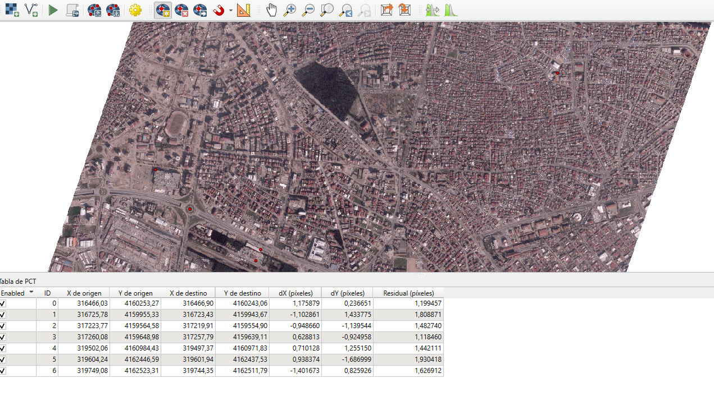
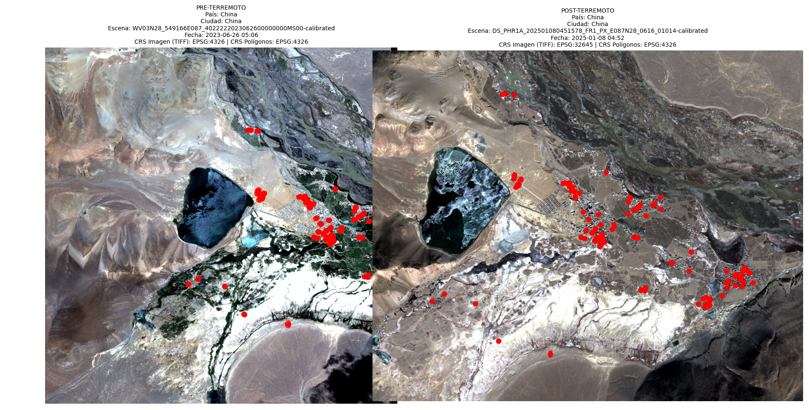
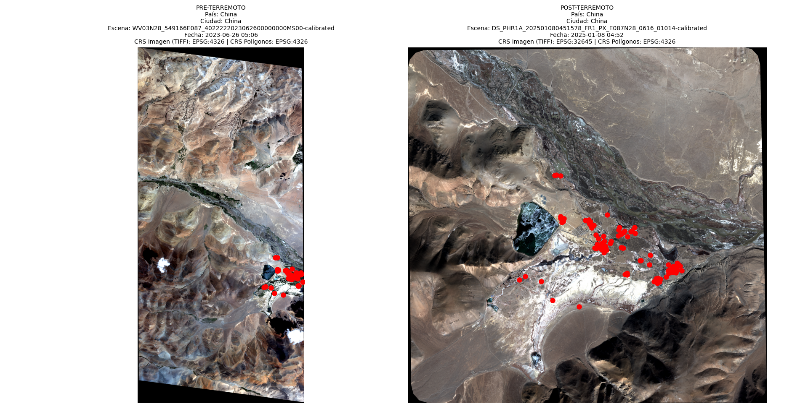
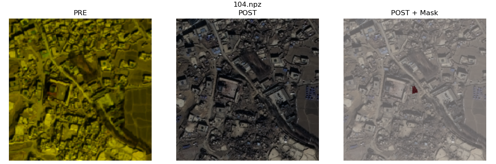
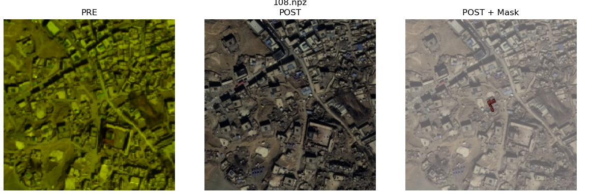

**English** | [Español](README.es.md)

# AI for Earthquake Response

Our solution for the [AI for Earthquake Response](https://platform.ai4eo.eu/ai-for-earthquake-response) competition by ESA Phi-lab and the International Charter "Space and Major Disasters".

The challenge: given high resolution satellite images from before and after an earthquake and the building polygons of the area, say which buildings are damaged (1) and which are not (0). The idea behind it is being able to generate damage maps quickly after an earthquake so rescue teams know where to go first.

The data covers earthquakes in Turkey (Adiyaman, Antakya, Marash), Syria, China, Morocco, Myanmar and Afghanistan, with images from different satellites (WorldView, Pléiades...), each one with its own resolution and bands.

## Approach

1. **Preprocessing**: for each building we look for the best pre and post event scene, crop a tile centred on the building (224 px by default, with a 20 m margin around it) and save it as `.npz` together with its label.
2. **Siamese model**: the same backbone processes the before and after tiles, and a head compares both representations to decide whether there is damage.
3. **Inference**: the trained model labels the buildings in the test `.gpkg` files and generates the submission files per city.


## Data

The data is not in the repo, you have to request it:

1. Sign up on the [AI4EO platform](https://platform.ai4eo.eu/ai-for-earthquake-response).
2. Create an account on [EOTDL](https://www.eotdl.com) with the same email.
3. Wait for access (it can take up to 48 h) and download the dataset into `data/international-charter-eo4ai-etq-challenge/`.


`objetivo.md` (in Spanish) has the full description of the dataset, the annotation format and what the submission has to look like.

## Preprocessing

`src/preprocess.py` does all the heavy lifting:

- Gets the earthquake date for each event and splits the scenes into pre and post.
- For each building it picks the best scene on each side based on coverage and closeness to the date, falling back to other scenes if the best one doesn't cover the polygon.
- Brings all scenes to a common resolution, crops the tile and rasterizes the building mask.
- Runs in parallel with several workers.

```bash
python src/preprocess.py \
  --data-root data/international-charter-eo4ai-etq-challenge \
  --output-dir preprocessed \
  --tile-size 224 \
  --buffer-meters 20
```

With `--country` you can process a single country and with `--satellites` filter by sensor.

Something we ran into right away is that a lot of buildings have no pre scene covering them. In one of the Afghanistan areas, for example, 78.7% of the buildings had no before image. That's why the scene matching has so many fallbacks.



### Why we ended up using QGIS

At first we tried to align the images and do the pansharpening only with code (`rasterio`, `gdal`, `opencv`), but there were misalignments between the pre and post layers that we couldn't get rid of, automatic pansharpening failed with the multispectral images and some projections weren't resolved correctly.

In the end we did that part in QGIS: load the pre and post images, fix the shifts with manual georeferencing using control points, do the pansharpening, export to GeoTIFF and feed the result into the `preprocess.py` pipeline. The QGIS projects for each country are in `data/*.qgz`. For a model that compares before and after, having both images well aligned is what matters most, and this improved the quality of the dataset quite a lot.

## Models

They are all in `src/model.py` and are selected with `--model`. The base one is `siamese_cnn_classifier`, and on top of that idea we tried different heads to compare pre and post:

| Model | Idea |
|---|---|
| `siamese_cnn_classifier` | Shared CNN backbone, concatenates pre and post features and classifies |
| `siamese_cnn_classifier_fpn` | Same but with an FPN to combine several scales |
| `correlation_siamese_head` | Correlation between the before and after feature maps |
| `cross_attention_transformer_head` | Cross attention between pre and post |
| `aspp_style_head` | ASPP style dilated convolutions |
| `relation_network_head` | Relation network between both branches |
| `temporal_conv3d_head` | Treats pre and post as a time sequence with 3D convolutions |
| `prototype_based_head` | Distance to class prototypes |
| `multitask_head` | Several outputs at once |
| `siamese_efficientnet_classifier` / `siamese_efficientnet_fpn` | Same with an EfficientNet-B0 backbone |

## Training

```bash
python src/train.py --config config.yaml --model siamese_cnn_classifier --epochs 10
```

Useful options:

- `--mode pre_post | pre_only | post_only`: which images to use.
- `--loss_type bce | dice | bce_dice | focal`: there are far fewer damaged buildings than undamaged ones, so the loss and the `class_weights` in the config matter quite a bit.
- `--small_dataset`: trains with 20% of the data for quick tests.
- `--resume`: to continue from a checkpoint.

Training has mixed precision, early stopping and a cosine scheduler with warmup. Logs can be viewed with TensorBoard or Weights & Biases.

## Inference and submission

```bash
python src/test.py \
  --model_path outputs/models/checkpoint_epoch_2.pth \
  --input_dir submissions/submission_1 \
  --output_dir submissions/submission_5
```

It generates one `.gpkg` per city (`adiyaman`, `antakya_east`, `china`, `marash`) with the label of each building. The ones we submitted are in `submissions/`.

## Visualization

To check the tiles and the predictions we used `src/visualizar_tiles.py` and `src/visualizar_escenas.py`.

| Close view | Wide view |
|---|---|
|  |  |





## Debugging scripts

`proof_scripts/` has the scripts we wrote along the way to debug the dataset: checking defective tiles, seeing which bands each scene has, listing image dates, viewing the content of the `.gpkg` files or a specific pre/post tile, checking augmented batches, etc. Several of them are specific to issues we had with Afghanistan and Adiyaman.

## Structure

```
AIFOREARTHQUAKE/
├── config.yaml            Main configuration
├── configs/               Other test configurations
├── data/                  QGIS projects (.qgz) and README images
├── src/
│   ├── preprocess.py      Scene matching and tile generation
│   ├── data_loader.py     Dataset and DataLoaders
│   ├── model.py           Siamese models and heads
│   ├── train.py           Training
│   ├── test.py            Inference and submission
│   ├── transforms.py      Augmentations
│   ├── sampler_aug.py     Sampler with augmentation
│   ├── train_backbone.py  Backbone pretraining
│   └── visualizar_*.py    Tile and scene visualization
├── proof_scripts/         Debugging and analysis scripts
├── submissions/           Submitted files
└── objetivo.md            Challenge and dataset description (Spanish)
```

## Installation

```bash
pip install -r requirements.txt
```

You need a CUDA GPU to train in a reasonable time. For preprocessing we used a separate conda environment with `rasterio`, `geopandas` and `fiona`.

## Team

[Sauvageduck24](https://github.com/Sauvageduck24) and [SilverDelgado](https://github.com/SilverDelgado).

MIT License.
